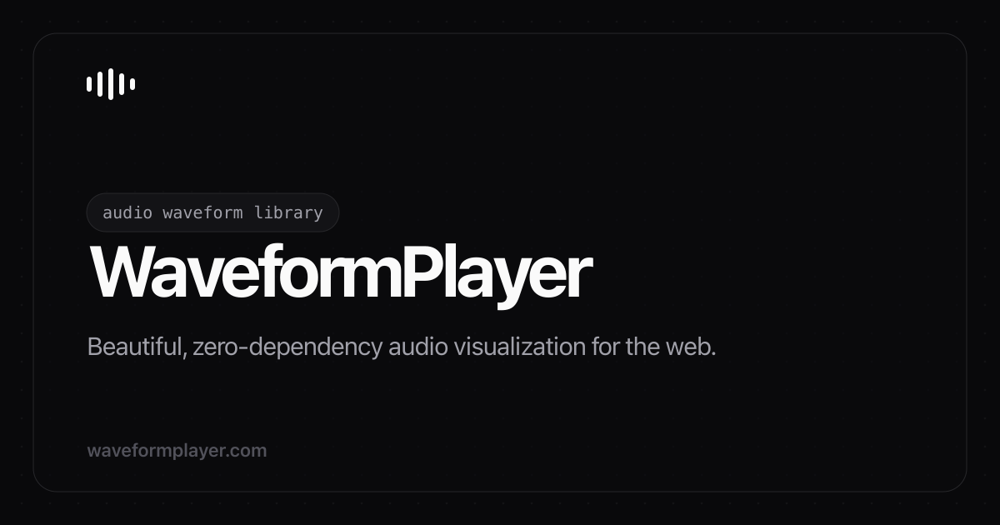

<p align="center">
  <a href="https://waveformplayer.com"></a>
</p>

<p align="center">
  <a href="https://waveformplayer.com"><b>Website</b></a> ·
  <a href="https://docs.waveformplayer.com"><b>Docs</b></a> ·
  <a href="https://www.npmjs.com/package/@arraypress/waveform-player"><b>npm</b></a>
  <br><br>
  <a href="https://www.npmjs.com/package/@arraypress/waveform-player"></a>
  <a href="https://www.npmjs.com/package/@arraypress/waveform-player"></a>
  <a href="https://github.com/WaveformPlayer/waveform-player/blob/main/LICENSE"></a>
</p>

**Zero-config audio waveforms for the web.** Add a `data-` attribute to any `<div>` and get a real, interactive waveform player. No build step, no dependencies.

```html
<link rel="stylesheet" href="https://unpkg.com/@arraypress/waveform-player/dist/waveform-player.css">
<script src="https://unpkg.com/@arraypress/waveform-player/dist/waveform-player.min.js"></script>

<div data-waveform-player data-url="track.mp3" data-title="My Song" data-artist="The Artist"></div>
```

Or with npm: `npm install @arraypress/waveform-player`

## Packages

| | Package | |
|---|---|---|
| **Core** | [`waveform-player`](https://github.com/WaveformPlayer/waveform-player) | Canvas waveform player with six visual styles, keyboard control and Media Session. Vanilla JS, zero dependencies. |
| **Extensions** | [`waveform-bar`](https://github.com/WaveformPlayer/waveform-bar) | A persistent bottom bar: queue, volume, repeat, favourites, cart, DJ markers and cross-page sessions. |
| | [`waveform-playlist`](https://github.com/WaveformPlayer/waveform-playlist) | Playlists and chapters for podcasts, courses, albums and audiobooks. Fully keyboard-accessible. |
| | [`waveform-sounds`](https://github.com/WaveformPlayer/waveform-sounds) | A searchable, filterable sound list for sample packs, with a mini waveform per row. |
| | [`waveform-tracker`](https://github.com/WaveformPlayer/waveform-tracker) | Privacy-first listen analytics that count real listening time. No cookies. |
| **Tooling** | [`waveform-gen`](https://github.com/WaveformPlayer/waveform-gen) | A Node CLI and library that pre-generates waveform peaks (and BPM) from audio files. |

### Framework components

| | Astro | React | Svelte | Vue |
|---|---|---|---|---|
| **Player** | [player-astro](https://github.com/WaveformPlayer/waveform-player-astro) | [player-react](https://github.com/WaveformPlayer/waveform-player-react) | [player-svelte](https://github.com/WaveformPlayer/waveform-player-svelte) | [player-vue](https://github.com/WaveformPlayer/waveform-player-vue) |
| **Bar** | [bar-astro](https://github.com/WaveformPlayer/waveform-bar-astro) | [bar-react](https://github.com/WaveformPlayer/waveform-bar-react) | [bar-svelte](https://github.com/WaveformPlayer/waveform-bar-svelte) | [bar-vue](https://github.com/WaveformPlayer/waveform-bar-vue) |
| **Playlist** | [playlist-astro](https://github.com/WaveformPlayer/waveform-playlist-astro) | [playlist-react](https://github.com/WaveformPlayer/waveform-playlist-react) | [playlist-svelte](https://github.com/WaveformPlayer/waveform-playlist-svelte) | [playlist-vue](https://github.com/WaveformPlayer/waveform-playlist-vue) |
| **Sounds** | [sounds-astro](https://github.com/WaveformPlayer/waveform-sounds-astro) | [sounds-react](https://github.com/WaveformPlayer/waveform-sounds-react) | [sounds-svelte](https://github.com/WaveformPlayer/waveform-sounds-svelte) | [sounds-vue](https://github.com/WaveformPlayer/waveform-sounds-vue) |

Every package is published on npm as `@arraypress/<name>`, for example `@arraypress/waveform-bar-react`.

The documentation site lives in [`waveform-docs`](https://github.com/WaveformPlayer/waveform-docs).

---

MIT licensed · Made by [ArrayPress](https://github.com/arraypress)
